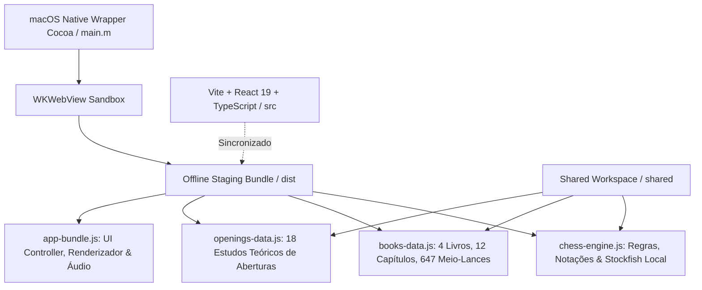

# Chess Mastery — Documentação Completa e Manual do Usuário

> **Versão:** 1.1.0  
> **Arquitetura:** Apple Silicon macOS Nativo (Cocoa + WKWebView) & Web/React 19  
> **Linguagens & Stack:** TypeScript, React 19, Tailwind CSS v4, Web Audio API, Stockfish Lite, Chess.js  
> **Repositório:** [https://github.com/fabiobertaiolli/chessmastery](https://github.com/fabiobertaiolli/chessmastery)

---

## 📖 1. Visão Geral e Propósito do Aplicativo

O **Chess Mastery** é uma academia interativa e estação de estudo de alta precisão dedicada a transpor a literatura clássica do xadrez para o ambiente digital contemporâneo. 

### 1.1 O Desafio Histórico
Durante séculos, as maiores obras-primas da pedagogia enxadrística — como o clássico brasileiro *Xadrez Básico* (Orfeu Gilberto D'Agostini) e o revolucionário *Meu Sistema* (Aron Nimzowitsch) — foram escritas exclusivamente em **Notação Descritiva** (`1. P4R P4R 2. C3BR C3BD`, etc.). Para os estudantes de hoje, habituados à **Notação Algébrica** (`1. e4 e5 2. Cf3 Cc6`), a leitura dessas obras apresenta barreiras severas:
1. **Dificuldade de decodificação:** A constante necessidade de traduzir mentalmente as coordenadas descritivas gera fadiga cognitiva e desvia o foco do aprendizado estratégico.
2. **Estudo estático e passivo:** Acompanhar um livro físico requer montar e movimentar manualmente as peças em um tabuleiro de madeira, ou digitar lances em bases PGN desconectadas do texto original.
3. **Ausência de treino prático:** Ler o lance do grande mestre antes de pensar atrofia o cálculo tático ativo do estudante.

### 1.2 A Solução do Chess Mastery
O Chess Mastery resolve integralmente essas dificuldades por meio de:
- **Pedra de Roseta Enxadrística em Tempo Real:** Conversão instantânea e bidirecional de qualquer lance entre Algébrica em Português (`Cf3`), Figurino (`♘f3`), Descritiva em Português (`C3BR`), Descritiva em Espanhol (`C3AR`) e Internacional (`Nf3`).
- **Navegação em Acordeão com Isolamento de Capítulos:** Todos os livros integrados estão disponíveis simultaneamente na barra lateral, permitindo expandir capítulos e isolá-los para estudo focado.
- **Enciclopédia & Repertório Teórico de Aberturas e Defesas:** Estudos estruturados das 18 principais aberturas clássicas e modernas, detalhando planos para as Brancas, planos defensivos para as Pretas, estruturas típicas de peões, armadilhas táticas e conexão direta com as partidas dos livros.
- **Modo Adivinhe o Lance (Spoiler-Free):** Ocultação total da planilha de lances e das anotações até que o estudante tente e encontre o lance do mestre diretamente no tabuleiro.
- **Motor Stockfish Local Embutido:** Avaliação posicional instantânea em centipawns e cálculo de melhores respostas, funcionando 100% offline em Macs com Apple Silicon (M1/M2/M3/M4) com consumo mínimo de memória (< 5 MB RAM).
- **Sintetizador Acústico Analógico:** Sons de alta fidelidade de peças de madeira (movimento, captura, xeque, roque e avisos de desafio) sintetizados matematicamente via Web Audio API pura, sem arquivos de áudio pesados.

---

## 🏛️ 2. Arquitetura do Sistema e Stack Tecnológica

O Chess Mastery adota uma arquitetura híbrida de alto desempenho:



### Componentes Principais:
1. **Wrapper Nativo macOS (`src-tauri/macos-native/main.m`):**
   - Construído diretamente em Objective-C com frameworks `Cocoa` e `WebKit`.
   - Inicializa a janela da aplicação configurada com proporções ideais (`1460x920`), suporte à aparência escura (`NSAppearanceNameDarkAqua`) e menus nativos do macOS.
   - Carrega o bundle autossuficiente diretamente da pasta `Resources/dist`, permitindo que o aplicativo funcione sem dependências de Node.js, Rust ou gerenciadores de pacotes na máquina do usuário final.
2. **Biblioteca Compartilhada (`@shared/ui/chess/`):**
   - `descriptiveNotation.js`: Conversores matemáticos de coordenadas e parser de notações históricas.
   - `openingsTheory.js`: Base de dados universal de teoria de aberturas, categorizações ECO e estratégias de peões.
   - `chessAudio.js`: Osciladores e envelopes de ganho que simulam o impacto acústico de peças de tília e jacarandá sobre tabuleiros de nogueira.
3. **Design System (*Obsidian Luxury & Grandmaster Atelier*):**
   - Base cromática: Superfícies OLED pretas e ardósia escura (`#080a0f`, `#0e121a`, `#141824`).
   - Acentos: Esmeralda (`#10b981`) para sucesso, lances magistrais e estados ativos; Âmbar (`#f59e0b`) para notações clássicas e avisos históricos; Celeste (`#0ea5e9`) para variantes teóricas e avaliação Stockfish; Carmesim (`#f43f5e`) para xeques e erros táticos.
   - Estrutura *Doppelrand* (duplo-bezel): Envoltórios externos maquinados com bordas ultrafinas de 1px e relevo sutil.

---

## 🖥️ 3. Guia da Interface do Usuário (UI/UX)

A interface é dividida em três regiões funcionais ergonomicamente planejadas:

### 3.1 Cabeçalho Superior (Top Bar)
- **Identidade:** Botão com ícone oficial, título e subtítulo da academia.
- **Navegador de Visão Central:**
  - `📚 Livros Mestres`: Alterna o ecossistema para a biblioteca de clássicos literários.
  - `♟️ Aberturas & Defesas`: Alterna para a enciclopédia de repertório teórico e defesas.
- **Seletor de Notação Dinâmica:** Botões segmentados que convertem todo o aplicativo instantaneamente:
  - `Algébrica PT`: Exibe peças em português (`Cf3`, `Bb5`, `O-O`).
  - `Figurino`: Substitui letras por ícones tipográficos universais (`♘f3`, `♗b5`).
  - `Descritiva (C3BR)`: Notação tradicional brasileira de D'Agostini (`C3BR`, `B5C`).
  - `Descritiva ES`: Notação tradicional espanhola de Nimzowitsch (`C3AR`, `A5C`).
  - `SAN (Nf3)`: Notação Internacional padrão FIDE em inglês.
- **Alternador de Modos:**
  - `📖 Leitura`: Modo de estudo assistido, exibindo notas do livro e planilha completa.
  - `🎯 Modo Adivinhe`: Ativa a mecânica de teste tático, ocultando os lances futuros.

---

### 3.2 Barra Lateral Esquerda (Navegador & Isolador de Conteúdo)
A barra lateral esquerda organiza todo o acervo do aplicativo:

#### Aba "Livros da Biblioteca"
1. **Filtro de Pesquisa em Tempo Real:** Campo de busca que filtra livros, capítulos, jogadores (ex: *Capablanca*, *Fischer*, *Tal*) ou eventos conforme o usuário digita.
2. **Acordeão de Livros:**
   - Cada livro é apresentado em um cartão moderno contendo título, autor, ano de publicação e quantidade de capítulos.
   - Clicar no cabeçalho do livro expande ou recolhe a lista dos seus capítulos internos.
3. **Modo de Capítulo Isolado (Recurso Principal):**
   - Ao clicar no botão **"Isolar ➔"** de um capítulo, a barra lateral oculta os demais livros e concentra-se 100% no capítulo escolhido.
   - O cabeçalho exibe o botão `← Voltar aos Capítulos`, permitindo retornar à visão geral a qualquer instante.
   - O cartão do capítulo exibe sua numeração, título pedagógico e a súmula de objetivos estratégicos.
   - Abaixo, são listadas todas as partidas do capítulo com título, jogadores, ano, código ECO e indicador visual de partida concluída (`✓`).

#### Aba "Aberturas & Defesas"
Organizada nas 5 categorias essenciais da teoria clássica e moderna:
- **⚔️ Aberturas Abertas (1.e4 e5)**
- **🛡️ Defesas Semi-Abertas (1.e4 contra Defesas Negras)**
- **🏰 Aberturas Fechadas (1.d4 d5)**
- **⚡ Defesas Semi-Fechadas & Sistemas Índios (1.d4 Cf6)**
- **🌐 Aberturas de Flanco & Réti**

Ao expandir uma categoria, o usuário visualiza cada estudo com seu nome, código ECO (ex: `B90`, `C50`) e perfil tático (`Agressivo`, `Posicional`, `Sólido`).

#### Rodapé de Portabilidade
- **Exportar:** Faz o download de um arquivo `.json` com o progresso do usuário e anotações pessoais.
- **Importar:** Carrega anotações e progresso salvos em outro computador.

---

### 3.3 Arena Central (O Tabuleiro Master)
- **Banners dos Jogadores (Superior e Inferior):**
  - Exibem a cor (Brancas/Pretas), nome do jogador, pontuação material adicional (`+1`, `+3`), peças capturadas e o distintivo luminoso `Vez de jogar`.
- **Barra de Avaliação Vertical (Stockfish Lite):**
  - Mostra a vantagem posicional com divisão dinâmica em branco e preto e pontuação numérica em centipawns (ex: `+1.4` para vantagem branca, `-0.8` para vantagem preta).
- **O Tabuleiro:**
  - Casas estilizadas com coordenadas embutidas nos cantos (`a-h`, `1-8`).
  - Destaque automático das casas do último lance jogado.
  - Marcadores de lances legais (círculos translúcidos para casas livres e anéis para capturas).
  - Badges táticos exibidos no tabuleiro no momento de lances especiais (`!`, `!!`, `!?`).
  - Suporte completo a anotações gráficas: clique com o botão direito desenha setas esmeralda e destaca casas coloridas.
- **Barra de Ferramentas Inferior:**
  - `⏮ Início`: Retorna à posição inicial (`Home`).
  - `◀ Anterior`: Volta um meio-lance (`←`).
  - `Contador`: Exibe o lance atual e o total de lances da partida (`ex: 18 / 41`).
  - `▶ Próximo`: Avança um meio-lance (`→`).
  - `⏭ Final`: Salta diretamente para o final da partida (`End`).
  - `🔄 Inverter`: Gira o tabuleiro em 180° (tecla `X` ou `F`).
  - `Seletor de Temas`: Alterna entre *Lichess Wood*, *Tournament Green*, *Walnut Classic* e *Obsidian Slate*.
  - `⚡ Stockfish`: Ativa ou desativa o motor de avaliação em tempo real.
  - `🔊 Áudio`: Alterna entre mudo e sons acústicos sintetizados.

---

### 3.4 Painel Direito (Estudo, Teoria & Planilha)
Possui duas abas principais de trabalho:

#### 1. Aba "Estudo & Teoria"
- **Faixa Rosetta de Notações:** No topo do painel, exibe o lance ativo em destaque e sua transcrição simultânea em Figurino e Notação Descritiva.
- **Se em Modo de Livro:**
  - Apresenta a tradução didática oficial do comentário do livro correspondente ao lance exibido no tabuleiro, destacando ideias e variantes recomendadas pelo autor.
  - Exibe a lista de **Lições Estratégicas do Capítulo**.
- **Se em Modo de Abertura:**
  - Card Hero com nome da abertura, código ECO e introdução histórica.
  - **⚪ Planos Estratégicos das Brancas:** Diretrizes concretas de desenvolvimento, rupturas de peão e alas de ataque.
  - **⚫ Planos & Defesa das Pretas:** Como neutralizar a iniciativa branca e onde construir o contra-jogo.
  - **♙ Estrutura de Peões & Casas Críticas:** Análise da cadeia central de peões.
  - **⚠️ Armadilhas & Erros Típicos:** Advertências táticas para não cair em golpes clássicos.
  - **Banner de Partida Modelo:** Botão de um clique que abre diretamente no livro a partida histórica que ilustra a abertura.

#### 2. Aba "Planilha de Lances"
- Tabela compacta sincronizada em duas colunas (Brancas e Pretas).
- O lance atualmente ativo no tabuleiro é destacado com fundo verde e tipografia em negrito.
- Pequenos pontos verdes assinalam lances que contêm notas e ensinamentos explicativos no livro.
- Clicar em qualquer lance da planilha move o tabuleiro instantaneamente para aquele ponto da partida.

#### 3. Modo "Adivinhe o Lance" (Desafio Interativo)
- A planilha e os comentários do livro são ocultados para evitar spoilers.
- O painel exibe o placar de desempenho:
  - **Acertos:** Número de lances corretos encontrados de primeira tentativa.
  - **Tentativas:** Total de movimentos testados.
  - **Sequência:** Quantidade de acertos consecutivos com indicador de fogo (`🔥`).
- Se o usuário mover a peça errada, recebe um aviso vermelho discreto com a jogada tentada, incentivando nova reflexão.
- Botão `💡 Dica`: Destaca a casa de partida da peça sem revelar o destino, acompanhada de conselho estratégico.
- Botão `Revelar`: Permite visualizar a solução caso o estudante deseje prosseguir.

---

## 📚 4. Catálogo Integrado: Livros Clássicos

O acervo pré-instalado foi higienizado e validado lance a lance através do JavaScriptCore:

### Livro 1: *Xadrez Básico* — Orfeu Gilberto D'Agostini
*A maior referência pedagógica do idioma português (Edição Clássica).*
- **Capítulo 1:** *As Partidas Modelo e as Razões dos Lances*
  - **Capablanca vs. Herman Steiner (1933):** Domínio de colunas abertas, cravadas e o sacrifício posicional em h6.
  - **Wilhelm Steinitz vs. Curt von Bardeleben (1895):** O Rei preso no centro e a combinação imortal `17. d5!`, `22. Txe7+!!`.
- **Capítulo 2:** *A Arte do Ataque e o Desenvolvimento Rápido*
  - **Paul Morphy vs. Duque de Brunswick & Conde Isouard (1858):** A célebre Partida da Ópera de Paris ensinando o desenvolvimento acelerado e o sacrifício de Dama `16. Db8+!!`.
- **Capítulo 3:** *Estratégia Superior — O Avanço Central e Casas Fracas*
  - **Mikhail Botvinnik vs. José Raúl Capablanca (AVRO 1938):** Estratégia posicional profunda e a deslumbrante manobra `30. Ba3!!`.
- **Capítulo 4:** *Finais Clássicos Indispensáveis*
  - **A Posição de Lucena (1497):** O método universal de construção da ponte com a Torre (`4. Td4!`) para promover o peão passado.

---

### Livro 2: *Meu Sistema (Mi Sistema)* — Aron Nimzowitsch
*A pedra fundamental do xadrez posicional e hipermoderno.*
- **Capítulo 1:** *Vantagem de Desenvolvimento e Ataque Central*
  - **Aron Nimzowitsch vs. Simon Alapin (1912):** O massacre do Rei no centro após ganho de tempos na abertura.
- **Capítulo 2:** *A Cadeia de Peões e a Arte do Bloqueio*
  - **Aron Nimzowitsch vs. Georg Salwe (1911):** O controle da casa forte `e5` e a imobilização completa da cadeia de peões preta com `12. Bf4!`.
- **Capítulo 3:** *O Princípio do Bloqueio e a Asfixia*
  - **Friedrich Sämisch vs. Aron Nimzowitsch (1923):** A Imortal do Zugzwang culminando no lance inacreditável `25...h6!!`.

---

### Livro 3: *Vida e Partidas de Mikhail Tal* — Mikhail Tal
*A estética do caos e o ataque intuitivo do 'Mago de Riga'.*
- **Capítulo 1:** *O Sacrifício Intuitivo e a Ruptura de Linhas*
  - **Mikhail Tal vs. Vasily Smyslov (Bled 1959):** O sacrifício `14. Cd5!` que desafiou a harmonia clássica de Smyslov.
- **Capítulo 2:** *O Cavalo em f4 e o Assalto ao Trono*
  - **Mikhail Botvinnik vs. Mikhail Tal (Moscou 1960, 6ª Partida):** O audacioso salto de Cavalo `21...Cf4!!` que abalou a solidez do 'Patriarca do Xadrez Soviético'.

---

### Livro 4: *Meus Grandes Predecessores (Vol. 4: Fischer)* — Garry Kasparov
*A ascensão do gênio americano analisada pelo 13º Campeão Mundial.*
- **Capítulo 1:** *A Partida do Século*
  - **Donald Byrne vs. Bobby Fischer (1956):** Aos 13 anos de idade, Fischer surpreende o mundo com `11...Ca4!!` e o eterno sacrifício de Dama `17...Be6!!`.
- **Capítulo 2:** *A Batalha de Reykjavik*
  - **Bobby Fischer vs. Boris Spassky (1972, 6ª Partida):** A transposição magistral para o Gambito da Dama e a quebra da ala do Rei com `20. e4!` e `38. Txf6!`.

---

## ♟️ 5. Catálogo do Repertório de Aberturas & Defesas

O Chess Mastery traz 18 linhas teóricas fundamentais com planos estratégicos detalhados:

| Categoria | Abertura / Defesa | Código ECO | Lance Chave | Ideia Central |
| :--- | :--- | :--- | :--- | :--- |
| **Abertas (1.e4 e5)** | Abertura Italiana (Giuoco Piano) | **C50** | `3. Bc4 Bc5 4. c3` | Ataque direto a f7 e formação do centro d4-e4. |
| **Abertas (1.e4 e5)** | Gambito Evans | **C52** | `4. b4! Bxb4 5. c3` | Sacrifício na ala da dama para ganho colossal de tempos. |
| **Abertas (1.e4 e5)** | Ruy López (Defesa Morphy) | **C70** | `3. Bb5 a6 4. Ba4` | Pressão posicional duradoura sobre o ponto central e5. |
| **Abertas (1.e4 e5)** | Ruy López (Variante das Trocas) | **C68** | `4. Bxc6 dxc6` | Dobra de peões e criação de maioria superior no final. |
| **Abertas (1.e4 e5)** | Abertura dos Quatro Cavalos | **C49** | `3. Nc3 Nf6 4. Bb5` | Simetria clássica e rompimento na coluna de Bispo (f). |
| **Abertas (1.e4 e5)** | Defesa Russa (Petroff) | **C42** | `2... Nf6 3. Nxe5 d6` | Contragolpe simétrico contra e4, base de solidez de Karpov. |
| **Semi-Abertas (1.e4 outros)** | Defesa Siciliana (Variante Najdorf) | **B90** | `5... a6 6. Be3 e5` | O ápice do dinamismo contra 1.e4; controle da casa b5. |
| **Semi-Abertas (1.e4 outros)** | Defesa Siciliana (Variante do Dragão) | **B70** | `5... g6 6. Be3 Bg7` | O Bispo de g7 varrendo a grande diagonal h8-a1. |
| **Semi-Abertas (1.e4 outros)** | Defesa Francesa (Variante do Avanço) | **C02** | `3. e5 c5 4. c3` | Batalha pela base da cadeia de peões brancos em d4. |
| **Semi-Abertas (1.e4 outros)** | Defesa Caro-Kann (Variante Clássica) | **B18** | `3. Nc3 dxe4 4... Bf5` | Solidez com desenvolvimento livre do Bispo antes de ...e6. |
| **Fechadas (1.d4 d5)** | Gambito da Dama Recusado (QGD) | **D30** | `2. c4 e6 3. Nc3 Nf6` | O bastião clássico mais respeitado em matches mundiais. |
| **Fechadas (1.d4 d5)** | Gambito da Dama Aceito (QGA) | **D20** | `2... dxc4 3. Nf3 Nf6` | Concessão do centro para contra-ataque ágil com ...c5. |
| **Fechadas (1.d4 d5)** | Defesa Eslava | **D10** | `2... c6 3. Nf3 Nf6` | Sustentação do centro mantendo a diagonal do Bispo aberta. |
| **Fechadas (1.d4 d5)** | Sistema London | **D02** | `2. Bf4 Nf6 3. e3` | Estrutura piramidal c3-d4-e3 com Bispo ativo em f4. |
| **Semi-Fechadas (1.d4 outros)** | Defesa Índia do Rei (Mar del Plata) | **E97** | `6... e5 7. d5 Ne7` | Fechamento central e avalanche de peões no flanco do Rei (...f5). |
| **Semi-Fechadas (1.d4 outros)** | Defesa Nimzoíndia (Rubinstein) | **E40** | `3... Bb4 4. e3 O-O` | Cravada do Cavalo de c3 e luta hipermoderna por e4. |
| **Semi-Fechadas (1.d4 outros)** | Defesa Grünfeld (Trocas) | **D85** | `3... d5 4. cxd5 Nxd5` | Demolição do grande centro branco à distância com ...c5. |
| **Flanco & Réti** | Abertura Inglesa (Quatro Cavalos) | **A28** | `1. c4 e5 2. Nc3 Nf6` | Controle assimétrico da casa d5 e flexibilidade máxima. |

---

## ⌨️ 6. Tabela de Atalhos de Teclado e Comandos

O Chess Mastery foi desenvolvido para navegação rápida sem necessidade constante de usar o mouse:

| Tecla / Comando | Função |
| :--- | :--- |
| `Seta para a Direita (→)` | Avança um meio-lance na partida ou abertura |
| `Seta para a Esquerda (←)` | Retorna um meio-lance |
| `Home` | Salta diretamente para a posição inicial do tabuleiro |
| `End` | Salta diretamente para o lance final do estudo |
| `X` ou `F` | Inverte a orientação do tabuleiro (Brancas / Pretas) |
| `Clique com Botão Direito` | Destaca casas no tabuleiro com halo esmeralda |
| `Arrastar com Botão Direito` | Desenha setas táticas vetoriais no tabuleiro |
| `Clique com Botão Esquerdo` | Remove todas as setas e círculos personalizados |

---

## 🛠️ 7. Compilação e Empacotamento do Aplicativo (.dmg)

Para gerar uma nova versão compilada para macOS Apple Silicon:

1. Abra o Terminal e navegue até a pasta do aplicativo:
   ```bash
   cd "/Volumes/Backup/antigravity01/Chess Mastery"
   ```
2. Execute o script automatizado de empacotamento:
   ```bash
   ./build_and_move.sh
   ```
3. O script realizará:
   - Limpeza de versões anteriores.
   - Compilação nativa com `/usr/bin/clang` linking Cocoa e WebKit.
   - Cópia do ícone oficial `.icns` e do bundle otimizado `dist/`.
   - Criação da imagem de disco UDZO comprimida (`Chess Mastery_1.0.0_aarch64.dmg`) na raiz do projeto.

---

## 📋 8. Suporte e Contribuições

O Chess Mastery é mantido dentro do workspace Antigravity por Fábio Bertaiolli. Relatórios de melhorias, novos livros ou variantes de abertura podem ser submetidos diretamente pelo repositório GitHub oficial:
👉 [https://github.com/fabiobertaiolli/chessmastery](https://github.com/fabiobertaiolli/chessmastery)
